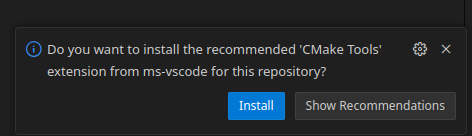
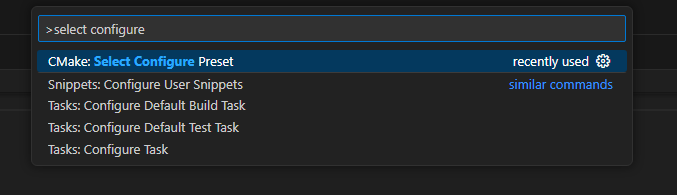
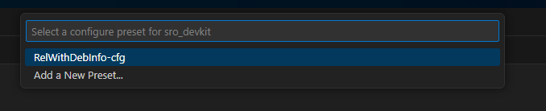
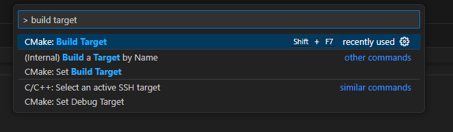
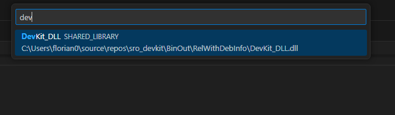
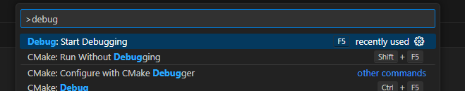

# Setup VSCode

## Setup

1. Follow [this guide](2005.md) to install Visual Studio 2005
2. Follow [this guide](../ninja.md) to install Ninja build
3. Install VSCode

## Open Project

1. Open the project
2. Install recommended plugins (CMake & C++), VSCode should notify you if you don't have them.  
   

3. Press Ctrl+Shift+P to open the command window
4. Type `select configure preset`, select it and press enter
   

5. Select RelWithDebInfo-cfg
   

6. Wait until configuration is done (should only take a few seconds)

7. Open command window again

8. Type `build target`, select this entry, press enter
   

9. Select `DevKit_DLL`
   

## Run and Debug

!!! important
    You must have a working game client in `BinOut/RelWithDebInfo/`. The client executable must load `DevKit_DLL.dll` as an imported dll or with LoadLibrary as the entry point. Just copy your whole game client to this folder.

1. Press Ctrl+Shift+P to open the command window
2. Type `debug` and select `Debug: Start Debugging`
   
3. In case you get another selection menu, select `Run client`
