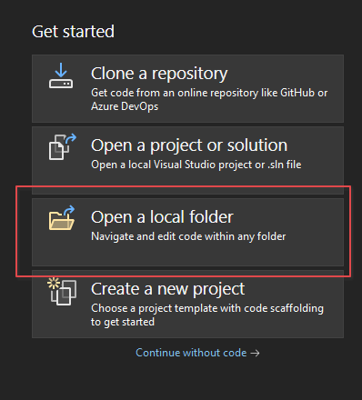
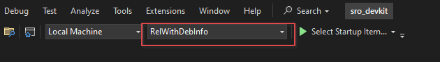
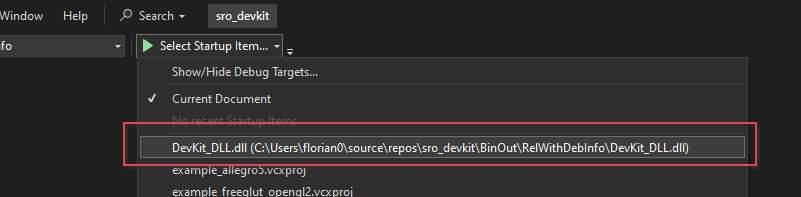
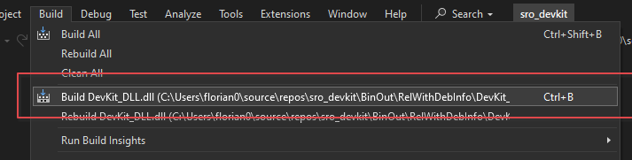

# Visual Studio (2020 and newer)

This guide requires a CMake-capable Visual Studio. As of today, 2020 and newer.

## Setup

1. Follow [this guide](../../required-tools/visual-studio-2005/index.md) to install Visual Studio 2005
2. Install 2020 or newer and select C++ support.

## Open Project

1. On the welcome screen, press Open a local folder.
   

2. Select Devkit Folder

3. Make sure that RelWithDebInfo is selected
   

4. Select DevKit_DLL as startup target
   

5. Click Build -> Build Devkit_DLL
   

"Build All" is currently broken and will never succeed. You always have to select DevKit_DLL as target, otherwise build fails.
